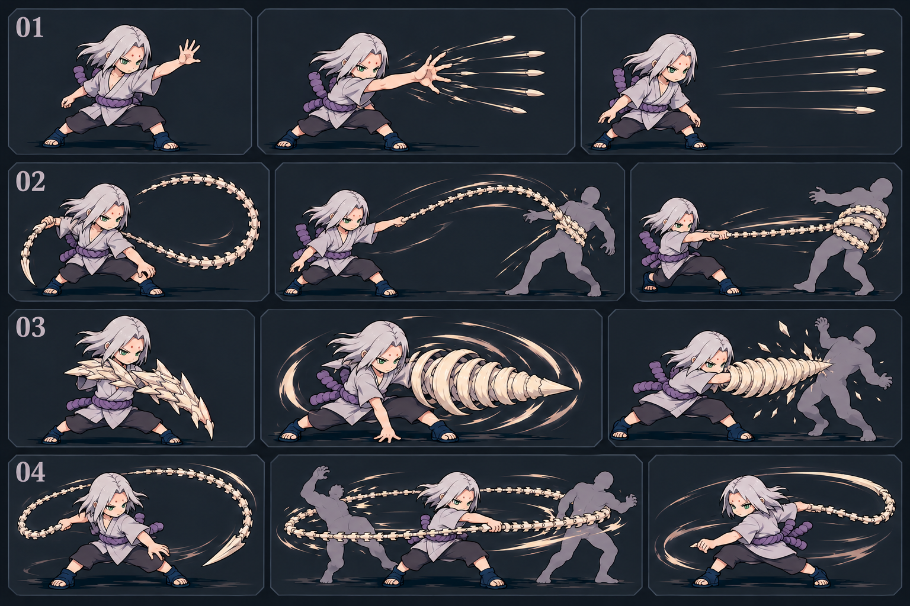

# 君麻呂完整設計與演出預覽

> 最新遊戲版已做[全技能範圍／割草感調整](../kimimaro-range-update.md)：早蕨半徑320～480、骨柱72組，其餘七招一起擴大。仍使用原多技能列，設計預覽舊數值不代表現行遊戲範圍。

> 2026-10-28 已接入首版可玩遊戲：[直接試玩君麻呂](http://127.0.0.1:8341/.omx/digimon.html?lang=zh-TW&hero=kimimaro)／[接線與驗證紀錄](../kimimaro-playable-delivery.md)。下方「獨立預覽」及設計階段的未接線說明保留為歷史；現在正式入口已有角色、八招與咒印。

> 最新實玩調整：[五自動／四主動](../kimimaro-auto-update.md)。穿彈、唐松、蔓學會後自動、不占主動格；Lv12早蕨按正常選卡可學，不要求先取得羈絆。

2026-10-27｜八招候選＋地之咒印。設計範圍已包含造型、玩法、數值、可播放演出、聲音草模與素材規格；沒有接入正式遊戲。

## 直接觀看

最新修訂：[森林中的屍骨脈：共同美術](art-direction.md)。依實際遊戲統一森林場景、既有敵人與冷白骨質；[看八招準備／命中／收勢24格](evidence/art-phases.png)。目前特效圖640×480、約143KiB，36柱／20次要粒子上限不變；場景重用素材約23KiB。

- [開啟獨立預覽](index.html)：八招、蔓接花、咒印可播放、慢放、拖曳時間軸；可切階級、數量、普通／二階及怪群／首領。
- [演出短片](evidence/kimimaro-motion-reel.webm)：由實際預覽錄製的無聲影片。
- [十組演出總覽](evidence/overview.png)／[完成交付](final-delivery.md)／[逐項稽核](evidence/completion-audit.json)。
- [最終主規格](final-spec.md)：目前唯一主規格，與 [共用資料](design-data.js) 對齊。
- [視覺與聲音製作規格](asset-production-spec.md)：配色、姿勢、來源、分層、方向與聲音材質。
- [八招五階試算](balance-v3.md)／[計算器](calculate-v3.py)／[試算結果](calculation-results-v3.json)。
- [逐段演出分鏡](presentation-v3.md)。

本機服務網址：[觀看君麻呂演出](http://127.0.0.1:8327/art-review/kimimaro-design/)。若服務尚未啟動，可從專案根目錄執行 `python -m http.server 8327 --bind 127.0.0.1`，再開上述網址。直接以檔案開啟可能受瀏覽器本機資源存取限制。

## 八招與形態

| 招式 | 主要體驗 |
| --- | --- |
| 柳之舞 | 4～8連、越斬越快的近身骨刃 |
| 椿之舞 | 可移動的細骨劍三連刺 |
| 十指穿彈 | 五拍、5～15枚指骨連射 |
| 唐松之舞 | 胸肋肩骨展開、短防護與反掃 |
| 鐵線花・蔓 | 脊骨鞭繃緊，普通怪短拉控位 |
| 鐵線花・花 | 骨片成鑽、一次重刺；可與蔓順接 |
| 鬼百合 | 寬幅雙圈周身掃鞭 |
| 早蕨之舞 | 三波骨林從地面逐層拔高 |
| 地之咒印 | 紋路、背骨、肉身尾與專用二階姿勢 |

招式為可學候選，沿用既有選招與羈絆成本。柳常駐，其餘按選中組施放；八招並非免費同時常駐。鬼百合正常形態可用、蔓花拆招及數值皆為本作改編。

## 圖像

[普通與五舞概念](concept-five-dances-v1.png)／[咒印與骨林分鏡](concept-transformation-storyboard-v1.png)。兩張舊板保留造型方向，時間與碰撞以最終規格為準。

預覽另有普通、二階各16個新繪透明關鍵姿勢，來源、矩形、腳底與渲染裁切記錄在 [actors.json](actors.json) 與 [生成紀錄](provenance-final.json)。側向與鏡射不等於全八方向圖集；關鍵姿勢插值不等於逐幀動畫原畫全部完成。

## 研究依據

- [原始素材與作者](research-assets.md)
- [官方影片入口](research-video.md)／[實際預覽縮圖取樣](research-official-motion-samples.md)
- [手游普通、咒印、漂泊、OL與新世代](research-mobile-games.md)
- [Storm、Connections、PS2、激忍與掌機](research-console-games.md)
- [Arena、Shinobi Legends、Shindo、MUGEN與素材線索](research-community-games.md)
- [Blazing、Ninja Voltage與Shinobi Collection](research-gacha-games.md)
- [本作實際程式適配審查](game-fit-review.md)

各來源標示官方、渠道、玩家、同人及觀看程度；僅找到影片不當作已完整看過。君麻呂研究圖集沒有接入預覽；場景中的寶可夢和樹石草重用專案既有資源，來源記在 [stage-assets.json](stage-assets.json)。

## 驗證與界線

[瀏覽器驗證程式](verify-preview.py)檢查桌機、手機直橫向、全部演出、真實雙圖集、操控、命中時點、數量、階級、AOE邊界、首領、取消與變身還原。圖集裁切亦驗證只顯示本姿勢，不混入鄰格尾巴。影片由同一預覽錄製。

這些證據針對設計預覽。正式遊戲接線、共用戰鬥效果、完整正背及受傷倒地圖、正式聲音檔與實戰平衡屬後續實作，沒有由本次預覽宣稱完成。

v1／v2／v3主稿及舊交付紀錄保留為歷史，不與 `final-spec.md` 並列為現行規則。
